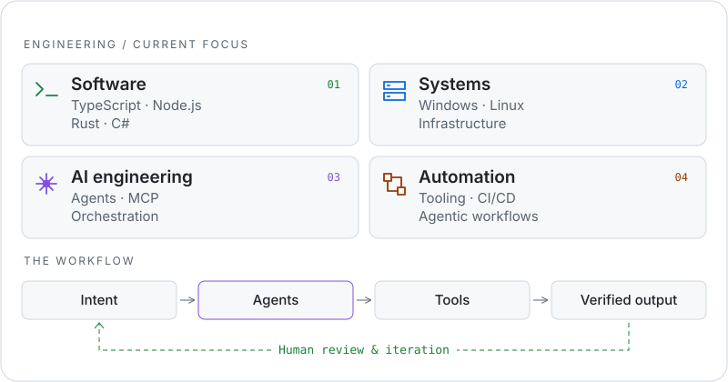

[](https://andreabrandi.com/)

**SOFTWARE · SYSTEMS · INTELLIGENCE**

## 20+ years of engineering.

20+ years in software & systems engineering across Windows and Linux.

Now fully focused on AI-first development, agentic workflows and automation.

My current stack is primarily TypeScript and Node.js, but my approach is increasingly language-agnostic — working across ecosystems, from Rust to C#.

I care about architecture, simplicity, reliability and the quality of what gets shipped.

### AI-first. Human-directed. Quality-driven.

<picture>
  <source media="(prefers-color-scheme: dark)" srcset="assets/engineering-dark.svg">
  <source media="(prefers-color-scheme: light)" srcset="assets/engineering-light.svg">
  
</picture>

---

```
🧠 My brain: I like to keep it next to where my heart used to be.
```

[Website](https://andreabrandi.com/) · [Substack](https://andreabrandi.substack.com) · [Instagram](https://www.instagram.com/andreabrandi.me/) · [Facebook](https://facebook.com/andreabrandi.me)


